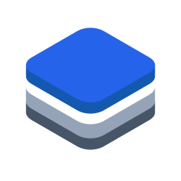
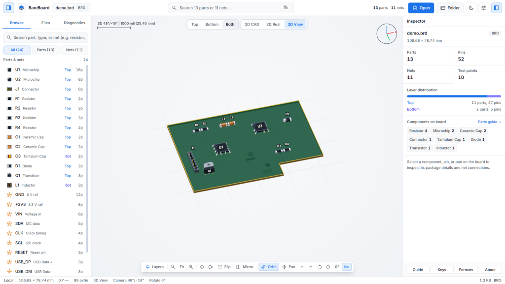
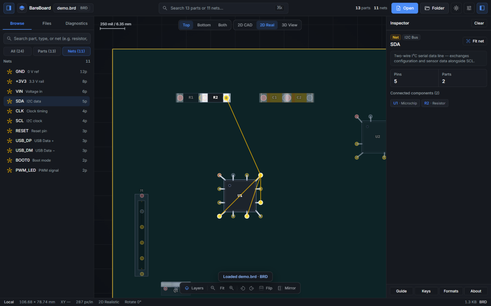
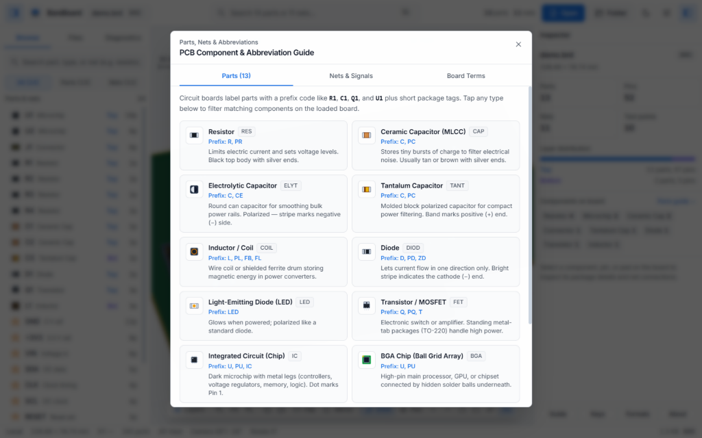
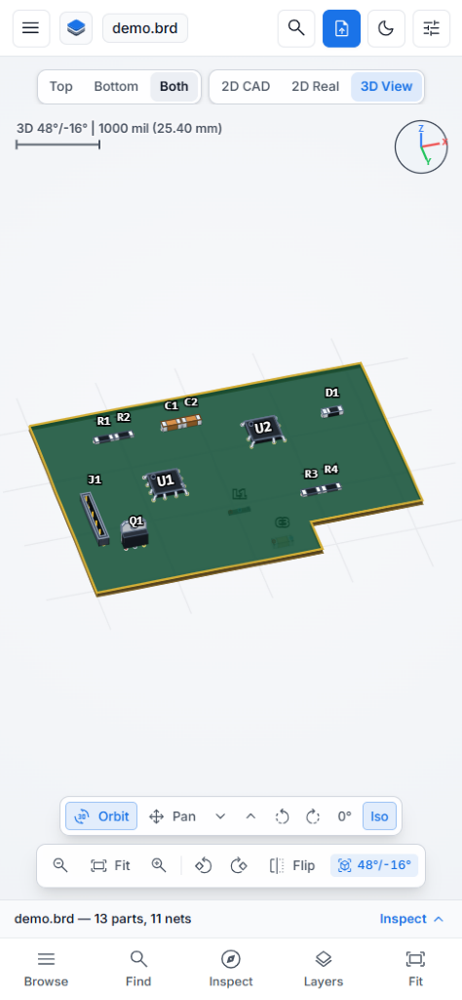

<div align="center">
  
  <h1>BareBoard</h1>
  <p>
    <strong>Offline-capable 2D CAD, 2D Realistic, and interactive 3D PCB boardview workbench in the browser.</strong><br />
    Inspect components, trace copper nets, explore pinouts, and identify board abbreviations locally on desktop or mobile.
  </p>
  <p>
    <a href="https://github.com/kicode01/bareboard/actions/workflows/ci.yml">
      
    </a>
    <a href="https://github.com/kicode01/bareboard/commits/main">
      
    </a>
    <a href="https://github.com/kicode01/bareboard/issues?q=is%3Aissue+is%3Aclosed">
      
    </a>
    <a href="https://github.com/kicode01/bareboard/blob/main/LICENSE">
      
    </a>
    
    
    
  </p>
</div>



<p align="center">
  
  
</p>

<p align="center">
  
</p>

---

## Features

- **Three Synchronized Render Modes**
  - **2D CAD** (`V`): Clean vector pads, outlines, Pin 1 markers, test points, and net airwires.
  - **2D Real** (`V`): Top-down illustrated SMD/through-hole component packages matching physical proportions.
  - **3D View** (`3`): Perspective-projected PCB substrate (`1.6 mm` FR-4 thickness) with standing TO-220 MOSFETs, radial electrolytic cans, shielded ferrite inductors, closed brushed-steel edge I/O shields, slotted headers, BGAs, QFNs/QFPs, and JEDEC-scaled passives.
- **Plain-English Component & Net Labels**
  - Inline component type tags (`Microchip`, `Ceramic Cap`, `Transistor`, `Resistor`, `Connector`, etc.), role descriptions, mount labels (`Surface-mount (SMD)`, `Through-hole`, `Ball grid (BGA)`), and net explanations (`GND`, `+3V3`, `VIN`, `SDA`/`SCL`, `USB_DP`/`USB_DM`, `RESET`, `BOOT0`, `CLK`, `PWM`, etc.) across Browse, Inspector, Pinouts, Command Palette, and hover tooltips.
  - Built-in **PCB Component & Abbreviation Guide** (`Parts (13)` · `Nets & Signals` · `Board Terms`) with one-click filtering on the loaded board.
- **Fast Search & Navigation (`⌘K` / `Ctrl+K`)**
  - Command Palette and virtualized Browse list match reference designators (`U1`, `Q7560`), plain-English types (`capacitor`, `mosfet`, `inductor`), net names (`SDA`, `PP3V3_S5`), and signal categories (`power`, `i2c`, `usb`, `clock`, `reset`, `boot`).
- **Desktop CAD Studio + Mobile Touch Workbench**
  - Collapsible/resizable Explorer & Inspector side rails on desktop (`1440×900+`); responsive slide-over drawers, bottom selection peek sheet, one-finger drag-orbit / pinch-zoom / long-press `3×` magnifier on phones (`< 860 px`).
- **Three Themes**: **Studio Dark**, **Studio Light**, and **Classic (WinForms)**.
- **100% Client-Side & Installable PWA**: All parsing happens locally in the browser with no backend upload, backed by `public/sw.js` for offline shell caching and OS file-handler integration (`launchQueue`).

---

## Supported Formats

| Format | Extension / Layout | Status | Notes |
| --- | --- | --- | --- |
| **BRD** | `.brd` | Supported | Classic text & `0x23E26328`-encoded BRD files (handles both `0x0c` SMD flags and side-only `1`/`2` exports) |
| **BRD2** | `.brd` | Supported | `BRDOUT:` / `NETS:` / `PARTS:` / `PINS:` / `NAILS:` variant with automatic Y-flip correction |
| **BDV** | `.bdv` | Supported | Subtractive-cipher ASC bundle (`<<format.asc>>` / `<<pins.asc>>` / `<<nails.asc>>`) |
| **BVR** | `.bvr` | Supported | `BVRAW_FORMAT_1` text layout |
| **BVR3** | `.bvr` | Supported | Key/value `PART_*` / `PIN_*` / `OUTLINE_*` format |
| **CAD** | `.cad` | Supported | GenCAD-style `COMP` / `C_PIN` / `NET` / `N_VIA` format |
| **CST** | `.cst` | Supported | Binary `CPad` boardview container |
| **ASC / TSICT** | Directory or `.zip` | Supported | Drop `format.asc`, `pins.asc`, and `nails.asc` together |
| **ZIP** | `.zip` | Supported | Expands single-file or multi-file boardview archives locally via `fflate` |
| **FZ / CAE / XZZPCB** | `.fz`, `.cae`, `.xzzpcb` | Not supported | Proprietary encrypted vendor key databases are intentionally excluded |

---

## Controls

| Desktop Shortcut | Action | Mobile Touch Gesture |
| --- | --- | --- |
| `Cmd/Ctrl + K` | Open Command Palette (parts, nets, commands) | **Tap Find** in bottom dock |
| `Ctrl + O` | Open boardview file | **Tap Upload** in top bar |
| `[` / `]` | Toggle Explorer / Inspector panels | **Browse / Inspect** dock buttons |
| `V` / `3` | Cycle `2D CAD`, `2D Real`, and `3D View` | Mode pills in top stage bar |
| `F` / Double-click | Zoom to fit board | **Tap Fit** |
| `Drag` (left button) | Pan (`2D`) or Orbit (`3D`) | **Single-finger drag** |
| `Wheel` | Cursor-centered zoom (`2D` & `3D`) | **Two-finger pinch** |
| `Right-drag` | `3×` Magnifier (`2D`) / Pan (`3D` while Orbit active) | **Long press** for `3×` magnifier |
| `R` / `,` / `.` | Rotate `90°` CW / CCW | Rotate buttons in floating dock |
| `Space` / `M` | Flip vertically / Mirror horizontally | Flip & Mirror tray |
| `T` / `B` | Top side only / Bottom side only | **Top / Bottom / Both** pills |
| `H` / `G` | Toggle Part Labels / Grid | **Layers** bottom sheet |
| `A W S D` / Arrows | Pan camera | — |
| `E` / `Enter` / `Esc` | Select under crosshair / Clear selection | **Tap** pad, pin, or component |

---

## Getting Started

Requires **Node.js 20+** and **npm**.

```bash
npm install
npm run dev        # Start Vite dev server
npm run check      # Run typecheck, validate all sample fixtures, and build dist/
npm run preview    # Serve production dist/ locally
```

### Individual Scripts

```bash
npm run typecheck  # TypeScript strict check (tsc -b)
npm run validate   # Bundle parsers and verify all fixtures in samples/
npm run build      # Production build into dist/ (relative base "./" for any static host)
```

`samples/` contains synthetic fixture boards for automated validation (`npm run validate`); `public/samples/` serves the built-in browser demo and reference samples at runtime.

---

## Architecture

```text
src/
  App.tsx                  Responsive Studio workbench, Classic theme shell, shortcuts, modals
  main.tsx                 App mount + bundled Inter variable font
  styles.css               Tailwind v4 + Base UI semantic tokens (Studio Dark / Light)
  styles-classic.css       Classic WinForms theme overrides
  types.ts                 Shared Board, Part, Pin, Nail, Layers, Selection interfaces
  parsers/
    detect.ts              Magic-byte & extension format detector
    text.ts                BRD, BRD2, BDV, BVR, BVR3, CAD, ASC/TSICT parsers
    binary.ts              CST binary parser
    util.ts                OpenBoardView MBB convex hulls, EPC Y-flip check, JEDEC neighbor clearance
    index.ts               Unified loadBoard() entrypoint + ZIP unwrapping
    demo.ts                Embedded demo.brd fixture loader
  render/
    BoardCanvas.tsx        DPR-aware 2D/3D canvas, hit-testing, hover tooltips, touch gestures
    realistic3d.ts         Package classifier, 2D Realistic drawer, perspective 3D component renderer
  lib/
    packages.ts            Component, net/signal, and PCB glossary metadata for beginner UX
    search.ts              Indexed part/net search supporting refdes + plain-English keywords
    geometry.ts            2D transforms, bounds fitting, polygon hit-testing
    theme.ts               Studio Dark, Studio Light, and Classic canvas palettes
    files.ts               File picker & directory drag-and-drop readers
    pwa.ts                 Service worker registration & launchQueue file-handler integration
    utils.ts               cn() Tailwind class helper
  components/
    ExplorerPanel.tsx      Virtualized Browse list, Files/samples browser, Diagnostics inspector
    InspectorPanel.tsx     Board stats, clickable component breakdown, part pinout, net/pin details
    ComponentGuideDialog.tsx 3-tab Parts, Nets & Signals, and Board Terms interactive guide
    CommandPalette.tsx     cmdk unified search & command launcher
    CanvasDock.tsx         Floating zoom/rotate/flip/3D orbit dock + Layers popover
    OptionsDialog.tsx      Theme & graphics settings dialog
    MenuBar.tsx / Toolbar.tsx  Classic WinForms menu bar & tool strip
    BrandMark.tsx / PackageGlyph.tsx / MaterialIcon.tsx  Dual Deck mark, package icons & SVG icons
    ui/                    Reusable shadcn/Base UI/Vaul primitives
```

---

## License

MIT — see [LICENSE](LICENSE).

BareBoard is an independent open-source boardview reader for inspecting PCB layouts locally in the browser and is not affiliated with or endorsed by third-party viewer vendors or hardware manufacturers. Trademarks belong to their respective owners.
