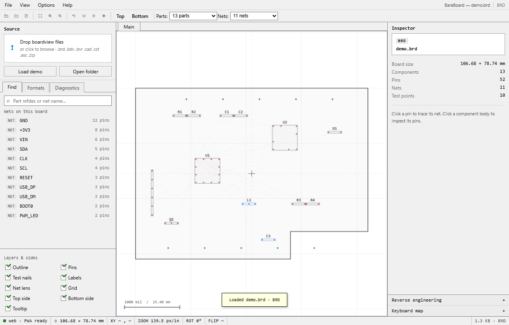
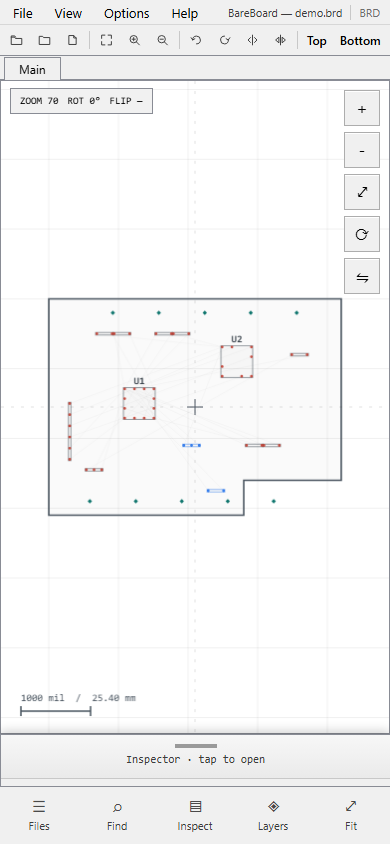
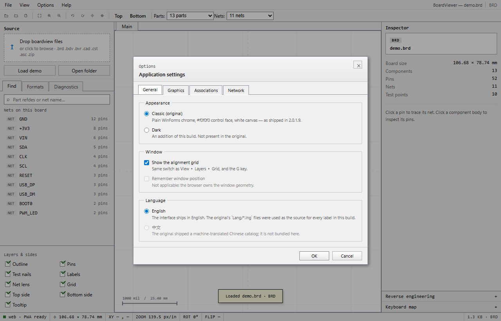

# BareBoard

**A boardview viewer that runs in a browser.** Open a bare board, trace a net, inspect a part — offline, on a phone.

A bare board is a PCB before any parts are placed on it: copper, pads and nets, no components. That is exactly what these files describe, so that is what this is called.



<p align="center">
  
  
</p>

---

## What it is

An independent reimplementation of **BoardViewer 2.0.1.8 / 2.0.1.9** — the Windows tool electronics repair techs use to open `.brd`, `.bdv` and `.cst` files and find their way around a motherboard.

The originals are Win32 desktop applications, and the formats they read have no official specification. This project reads those formats directly and renders them with Canvas 2D, so the same board opens on a phone, a tablet, or a laptop, works with no network, and installs as a PWA.

No proprietary code, binary or artwork from the original applications is included or required.

## Why bother

Because the alternative is a Windows-only executable from 2019 that you cannot open on the bench tablet you actually carry, cannot search, and cannot read on a phone at 3 a.m.

## Formats

| Format | Status | Notes |
| --- | --- | --- |
| **BRD** | ✅ | The classic `str_length:` / `var_data:` / `Format:` text format |
| **BRD2** | ✅ | Newer text variant with a different header |
| **BDV** | ✅ | Binary boardview |
| **BVR** | ✅ | Binary, multiple revisions |
| **CAD** | ✅ | GenCAD-style ASCII netlist + geometry |
| **CST** | ✅ | Test-link style compact format |
| **ASC / TSICT** | ✅ | Folder format — `format.asc`, `pins.asc`, `nails.asc` together |
| **ZIP** | ✅ | Unwraps the above |
| FZ | ❌ | Encrypted with a vendor key that ships in a separate database |
| CAE | ❌ | Same problem |

The two encrypted formats are deliberately out of scope: they need a key database that cannot be shipped in a browser build, and OpenBoardView has the same requirement.

## Features

- **Open** by file picker, drag-and-drop, or folder (for the multi-file ASC format). Accepts `.zip`.
- **Navigate** with pan, zoom, pinch, rotate in 90° steps, flip to the other side, mirror.
- **Trace** a net by tapping a pin, or select a part to see its pins and the nets they belong to.
- **Search** parts and nets by name or reference designator.
- **Layers** — outline, pins, test nails, labels, nets, grid, top side, bottom side, tooltips.
- **Inspect** — part body, footprint, pin list, net membership, board statistics.
- **Two themes** — `Classic`, a reproduction of the original WinForms chrome, and `Dark`.
- **Keyboard** — `Ctrl+O`, `F` fit, `R` rotate, `Space` flip, `M` mirror, `E` select under crosshair, `Esc` clear, and more.
- **Touch** — pinch to zoom, long-press for a 3× magnifier, bottom sheet for inspection.
- **Accessible** — every control reachable by keyboard, focus trapped in overlays, `aria-pressed` / `aria-expanded` / `role="dialog"` throughout, contrast at or above WCAG AA, honours `prefers-reduced-motion`.
- **Offline** — installable PWA with a runtime cache-first service worker.

## Run it

```bash
npm install
npm run dev        # dev server
npm run build      # production build
npm run preview    # serve the build
npm run validate   # parse every file in samples/ and report what came out
```

`samples/` holds small synthetic boards in each supported format. They are hand-authored fixtures for the parser tests, not real customer boards.

## How it works

```
src/
  parsers/     format detection + one reader per format, all returning the same Board
  render/      BoardCanvas — Canvas 2D, DPR-aware, pointer/touch gestures
  components/  MenuBar, Toolbar, OptionsDialog, inspector, search, layers
  lib/         theme + canvas palettes, geometry helpers, unit formatting
```

Every parser returns the same `Board` shape, so the renderer and the whole UI are format-agnostic. Colours live in a per-theme `Palette` object passed into the canvas rather than being hardcoded in the drawing code, which is what makes two complete themes possible from one markup tree.

The responsive shell is one component tree, not two: below 860 px the left panel becomes an overlay drawer and the inspector becomes a three-state bottom sheet, but no function is dropped.

## How the original was taken apart

This is the part that made the project possible, so it is worth stating plainly.

Both executables are obfuscated with **ConfuserEx v1.0.0** — control flow flattened into `switch` dispatchers, calls routed through proxy stubs, constants encrypted, resources sealed with PBKDF2 + Rijndael. Of 211,532 decompiled lines, only five identifiers survived, and the entire 24 MB of IL contains 25 `ldstr` instructions, all of them empty.

What did survive: the `Lang/*.lng` catalogues, which are `key=value` pairs where **the key is the English source string** — 163 keys in 2.0.1.8 and 322 in 2.0.1.9. Every menu label, keyboard shortcut and error message in this project comes from those files rather than from guessing.

The classic theme's colours are not invented either. The 2.0.1.8 archive ships a manual with four screenshots embedded as images; they were extracted and pixel-sampled for the control face (`#f0f0f0`), window (`#ffffff`), border (`#898c95`) and tooltip (`#ffffe1`), and cross-checked against `Color.FromArgb` constants that survive in the decompiled sources.

The "Enhanced" plug-in turned out to be a separate 易语言 native executable, not a DLL — it embeds itself into the host window with `SetParent` and `SetWindowsHookEx`, and imports no synthetic-input functions at all.

## Known limits

- **FZ and CAE** are not supported, as above.
- **Board drawing colours are an assumption.** The original builds them from float constants inside the encrypted pool, and no available screenshot shows a loaded board. This build uses the industry convention — top side red, bottom side blue.
- **CST pad advance** is ambiguous in the format (10 vs 12); the reader assumes 10.
- **No part catalogue.** 2.0.1.9 added a SQLite/Volante-backed parts database with brand and category browsing. It is not reproduced, and there is no online lookup.
- **No vendor keys.** The FZ/CAE key databases and the XZZPCB XOR key are deliberately absent.

## Built with AI assistance

This was built in an assisted session with WorkBuddy AI. The reverse-engineering tooling — the ECMA-335 metadata reader, the IL splitter, the PDF image extractor, the cross-viewport CDP test harness — was written during that session too, and it is what produced the findings above. Saying so seems more useful than pretending otherwise.

## License

MIT — see [LICENSE](LICENSE).

Not affiliated with, endorsed by, or derived from the BoardViewer authors. Trademarks and format names belong to their respective owners. This is an independent reader for file formats, written from observation of files and of publicly shipped documentation.
